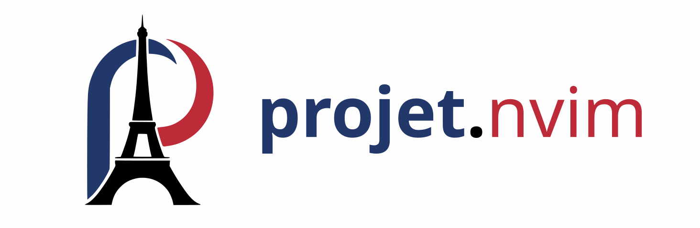

**It’s a project manager without the complexity — so we dropped the “c”.**

Projet is a minimalist tool for managing your Neovim projects, with just enough French to feel fancy.

## 💡 What is it?

Your project manager is simply a list stored in a buffer.
Each line contains a project tag (a short name) followed by the path to
the project directory, separated by a space:
```text
super-secret ~/dev/super-secret
coolbeans ~/dev/coolbeans
dotfiles ~/.dotfiles
blog ~/projects/my-tech-blog
projet.nvim ~/.config/nvim/lua/projet
telescope-fork /home/user/opensource/telescope.nvim
cv /home/user/Documents/resume-latex
data-crunch /home/user/work/data-cruncher
school-backend /home/user/repos/school-api
```
That's it!

---

## ✨ Features

- 🪟 Floating buffer interface to manage and switch between projects
- 🔍 Telescope integration: `:Telescope projet`
- 🛠️ Customizable key mappings and behavior
- 📁 Choose your own action when selecting a project
- 🧩 Can be used standalone, with Telescope, or integrated into any other picker or UI

---

## 🚀 Installation

Using [lazy.nvim](https://github.com/folke/lazy.nvim):

```lua
{
  "tiagovla/projet.nvim",
  config = function()
    require("projet").setup()
  end,
}
```

---

## 🔧 Configuration

Here are the default configuration options:

```lua
require("projet").setup({
  database_path = vim.fs.joinpath(vim.fn.stdpath("data"), "project.json"),
  mappings = {
    { "n", "q", require("projet.editor").close },
    { "n", "<ESC><ESC>", require("projet.editor").close },
    {
      "n",
      "<CR>",
      function()
        require("projet.editor").select(function(project)
          vim.cmd("bcd " .. project.path) -- you might want to use a picker
        end)
      end,
    },
  },
})
```

You can override this by passing a custom config to `setup()`.

---

## 📚 Usage

### Open the floating editor

```lua
require("projet").toggle_editor()
```

Or bind it to a key in your config:

```lua
vim.keymap.set("n", "<leader>p", require("projet").toggle_editor)
```

### Telescope Integration

Launch the Telescope picker with:

```vim
:Telescope projet
```

(Ensure you have Telescope installed and configured.)

---

## 📦 Data Format

Projects are saved as a simple JSON array at the configured `database_path`.  
Example:

```json
[
  { "name": "MyApp", "path": "/home/user/dev/myapp" },
  { "name": "Dotfiles", "path": "/home/user/.dotfiles" }
]
```

---

## 📝 License

MIT — feel free to use, modify, and share.
